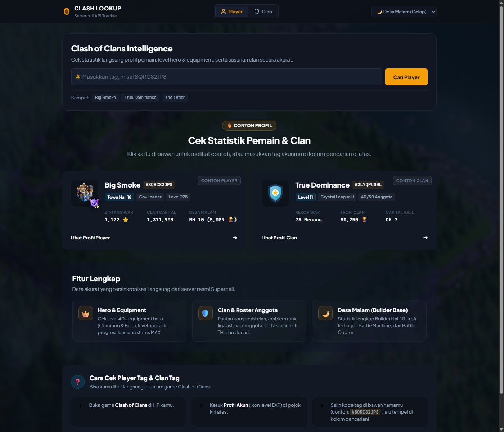

# ⚔️ Clash Kiw — Clash of Clans Player & Clan Intelligence

A modern, lightning-fast, and modular fullstack web application for looking up live **Clash of Clans** player statistics, clan rosters, hero equipment progression, and **comprehensive upgrade resource & duration estimations** powered by the official Supercell API.

[](https://clash-kiw.vercel.app/)


<p align="center">
  
</p>

---

## 🌟 Fitur Utama (Key Features)

### 1. 👤 Profil Pemain Lengkap (Player Profile)
- **Badge Resmi Supercell**: Menampilkan badge liga dinamis (Dragon League, Titan, Legend, dsb.) dan badge clan resmi.
- **Visual Gedung Town Hall HD**: Gambar gedung Town Hall tingkat lanjut (TH1–TH18) lengkap dengan bintang senjata (*Giga Tesla/Inferno*).
- **Rasio Donasi Pasukan Modern**: Perbandingan visual donasi Terkirim (*Emerald*) vs Diterima (*Sky Blue*) dengan indikator persentase interaktif.
- **Statistik Home Village & Ekonomi**: Level EXP, trofi terkini & rekor tertinggi, bintang war, attack & defense win counter, serta total kontribusi Clan Capital.
- **Desa Malam (Builder Base)**: Preview Builder Hall (BH1–BH10), trofi Desa Malam, serta unit khusus Builder Base (*Battle Machine, Battle Copter, dan Pasukan BB*).
- **Gaya Bermain (Playstyle Labels)**: Menampilkan label resmi Supercell lengkap dengan ikon representatif.

---

### 2. ⚡ Kalkulator Upgrade Resource & Durasi Waktu (Upgrade Calculator & Estimator)
Fitur unggulan untuk menganalisis kebutuhan resource dan waktu tukang/laboratorium yang dibutuhkan pemain:
- **Dukungan Seluruh Kategori Unit**:
  - 👑 **Heroes**: *Barbarian King, Archer Queen, Grand Warden, Royal Champion, Minion Prince, Dragon Duke* (Biaya Dark Elixir / Elixir + Durasi hari/jam).
  - 🔮 **Hero Equipment**: Common & Epic (*Shiny, Glowy, dan Starry Ore* — Instan `0s` tanpa waktu tukang).
  - ⚔️ **Pasukan (Troops)**: Elixir & Dark Elixir troops (Level 1 sampai MAX).
  - 🧪 **Spells**: Elixir & Dark Elixir spells.
  - 🛡️ **Siege Machines**: Mesin tempur darat & udara.
  - 🐾 **Pets**: 12 Hero Pets (*L.A.S.S.I, Electro Owl, Mighty Yak, Unicorn, Frosty, Diggy, Poison Lizard, Phoenix, Spirit Fox, Angry Jelly*, dll.).
  - 🔨 **Desa Malam**: Hero & Pasukan Builder Base (*Builder Elixir*).
- **Badge Ringkas pada Setiap Kartu Unit**: Menampilkan biaya dan estimasi waktu 1x upgrade berikutnya (contoh: `⏱️ 5h`, `⏱️ 12j`, `⏱️ 2.5bln`) di samping biaya resource.
- **Modal Popup Rincian Upgrade Interaktif**:
  - Klik kartu unit mana saja untuk membuka popup modal detail.
  - **Biaya ke Level Selanjutnya**: Resource dan durasi waktu upgrade spesifik untuk 1 level berikutnya.
  - **Total Sisa Menuju MAX**: Total akumulasi seluruh resource dan seluruh waktu tukang/laboratorium yang dibutuhkan untuk menuntaskan unit tersebut ke MAX.
- **Banner Akumulasi Total per Kategori**:
  - Diletakkan di atas setiap tab kategori Armory.
  - **Biaya 1x Upgrade Berikutnya**: Menjumlahkan seluruh biaya dan waktu yang diperlukan jika semua unit non-max dinaikkan 1 level.
  - **Total Sisa Menuju Semua MAX**: Menghitung kalkulasi kumulatif resource dan total durasi waktu untuk memaxkan **seluruh unit di kategori tersebut**.
  - Status pencapaian kategori (contoh: `🏆 0/6 MAX`, `⚡ 167 Level Tersisa`).

---

### 3. 🛡️ Profil Clan & Roster Anggota Interaktif (Clan Intelligence)
- **Ringkasan Lengkap Clan**: Level clan, total poin trofi, jumlah anggota (`x/50`), war league tier, capital hall level, syarat trofi masuk, frekuensi perang, dan war win streak.
- **Catatan & Rekor War**: Total Menang / Kalah / Seri dengan penanganan war log privat secara rapi.
- **Tabel Anggota Interaktif**:
  - **1-Click Player Inspection**: Klik baris anggota clan mana saja untuk langsung memeriksa profil detailnya.
  - **Pencarian Real-Time**: Input filter instan untuk mencari anggota berdasarkan nama atau tag.
  - **Multi-Sort Dinamis**: Urutkan anggota clan berdasarkan **Trofi**, **Town Hall**, **Donasi**, atau **Nama (A-Z)**.

---

### 4. 🎨 UI/UX Modern & Desain Bertema
- **Pencarian Ganda**: Navigasi cepat antara tab **Cari Player** dan **Cari Clan**.
- **Contoh Cepat (Quick Samples & Spotlight)**: Contoh akun populer (*Big Smoke* & clan *True Dominance*) dalam wadah kartu yang terstruktur rapi.
- **Dukungan Deep Linking**: URL sinkron otomatis (`?player=TAG` atau `?clan=TAG`) dengan tombol salin tautan langsung.
- **Riwayat Pencarian (Recent Searches)**: Menyimpan riwayat pencarian terbaru di `localStorage` dengan tombol hapus cepat.
- **Tema Suasana Desa**:
  - 🌙 **Desa Malam (Gelap)**: Suasana malam taktis dengan aksen dark glassmorphism.
  - ☀️ **Desa Siang (Terang)**: Suasana cerah dengan wallpaper desa siang dan kontras yang telah disesuaikan.
- **In-Memory TTL Cache (2 Menit)**: Mengurangi latensi respons hingga **~4ms** pada pencarian berulang serta menghemat kuota Supercell API.

---

## 📸 Screenshots & Showcase

| Halaman Beranda (Landing Page) | Profil Pemain & Armory |
| :---: | :---: |
|  |  |

| Showcase Equipment & Ores | Profil Clan & Roster Interaktif |
| :---: | :---: |
|  |  |

---

## 📁 Struktur Direktori (Modular Architecture)

Proyek ini dibangun menggunakan **ES Modules (ESM)** native tanpa bundler yang rumit, menjaga kecepatan muat dan kemudahan modifikasi:

```text
Clash-of-Clans-Lookup-Players/
├── docs/                                 # 📸 Dokumentasi & Screenshot
│   └── screenshots/
│       ├── home-landing.png
│       ├── player-profile.png
│       ├── hero-equipment.png
│       ├── clan-profile.png
│       └── daylight-theme.png
│
├── src/                                  # ⚙️ Backend (Express & Node.js)
│   ├── config.js                         # Variabel konfigurasi & environment
│   ├── server.js                         # Entrypoint server Express
│   ├── controllers/
│   │   ├── playerController.js           # Handler data profil, hero, & armory
│   │   └── clanController.js             # Handler data clan & roster anggota
│   ├── routes/
│   │   └── apiRoutes.js                  # Definisi route REST API
│   └── services/
│       ├── clashApi.js                   # Client HTTP resmi Supercell & validator tag
│       └── cache.js                      # Mesin cache in-memory TTL (2 menit)
│
├── public/                               # 🌐 Frontend Web Application
│   ├── index.html                        # Markup utama (<script type="module">)
│   ├── app.js                            # Frontend controller & orchestrator
│   ├── style.css                         # Master stylesheet (mengimpor berkas modular CSS)
│   │
│   ├── css/                              # 🎨 Modular Stylesheets
│   │   ├── variables.css                 # Color tokens, fonts, & variable tema
│   │   ├── layout.css                    # Layout reset, navbar, & wallpaper desa
│   │   ├── components.css                # Komponen search bar, chips, toast, badge
│   │   ├── home.css                      # Styling spotlight landing page & panduan
│   │   ├── player.css                    # Card pemain, armory grid, & modal upgrade
│   │   ├── clan.css                      # Card clan, statistik war, & tabel roster
│   │   └── responsive.css                # Breakpoint perangkat mobile & tablet
│   │
│   ├── js/                               # ⚡ Native ES Modules
│   │   ├── dom.js                        # Cache selector elemen DOM
│   │   ├── api.js                        # Helper wrapper fetch request
│   │   ├── toast.js                      # Sistem notifikasi interaktif
│   │   ├── clipboard.js                  # Handler salin tag & deep-link sharing
│   │   ├── formatters.js                 # Formatter peran, tipe clan, & label
│   │   ├── assets.js                     # Clash King HD asset resolvers
│   │   ├── upgradeCalculator.js          # Kalkulator biaya & estimasi durasi waktu
│   │   ├── theme.js                      # Controller tema Desa Siang & Malam
│   │   ├── history.js                    # Manajer riwayat pencarian localStorage
│   │   ├── player.js                     # Renderer profil pemain & modal upgrade
│   │   └── clan.js                       # Renderer profil clan & roster interaktif
│   │
│   └── assets/                           # Ikon resource resmi & wallpaper HD
│       ├── res-elixir.png                # Asset Supercell Elixir
│       ├── res-dark-elixir.png           # Asset Supercell Dark Elixir
│       ├── res-builder-elixir.png        # Asset Supercell Builder Elixir
│       ├── res-shiny-ore.png             # Asset Supercell Shiny Ore
│       ├── res-glowy-ore.png             # Asset Supercell Glowy Ore
│       ├── res-starry-ore.png            # Asset Supercell Starry Ore
│       ├── true-dominance.png            # Badge Clan True Dominance
│       ├── bg.jpg                        # Wallpaper Desa Siang
│       └── bg-night.jpg                  # Wallpaper Desa Malam
│
├── vercel.json                           # Konfigurasi deployment serverless Vercel
├── render.yaml                           # Konfigurasi deployment Render
└── package.json                          # Manifest dependensi & skrip Node.js
```

---

## 🚀 Panduan Menjalankan Secara Lokal (Local Setup)

### 1. Clone Repositori & Pasang Dependensi
```bash
git clone https://github.com/KiyyKen/Clash-of-Clans-Lookup-Players.git
cd Clash-of-Clans-Lookup-Players
npm install
```

### 2. Konfigurasi Environment Variables
Salin berkas `.env.example` atau buat berkas `.env` baru pada direktori root proyek:
```env
COC_API_KEY=masukkan_token_supercell_api_kamu_di_sini
PORT=3000
```

> [!IMPORTANT]
> **Supercell API IP Whitelist:**
> Clash of Clans Developer Portal mewajibkan **Allowed IP Address** sesuai dengan IP publik koneksi internet kamu. Cek IP publik saat ini (misal via [ipify.org](https://api.ipify.org)) dan tambahkan ke konfigurasi key di [developer.clashofclans.com](https://developer.clashofclans.com/).

### 3. Jalankan Aplikasi

**Mode Pengembangan (Auto-reload dengan nodemon):**
```bash
npm run dev
```

**Mode Produksi:**
```bash
npm start
```

Buka peramban (browser) di:
👉 **`http://localhost:3000`**

---

## ☁️ Panduan Deployment (Vercel)

Aplikasi ini sudah dioptimalkan dan siap di-deploy langsung ke [Vercel](https://vercel.com):

1. **Push kode** ke repositori GitHub kamu.
2. Buka dashboard Vercel, lalu pilih **New Project** dan impor repositori.
3. Masukkan **Environment Variables**:
   - `COC_API_KEY`: Token API dari portal pengembang Supercell.
4. Klik **Deploy**. Vercel akan otomatis membaca file `vercel.json` dan menyajikan frontend statis sekaligus serverless function Express.

> [!TIP]
> Jika mendeploy di Vercel atau penyedia cloud lain yang IP-nya dinamis, pastikan API Key Supercell mengizinkan rentang IP server deployment kamu, atau gunakan proxy IP statis jika diperlukan.

---

## 🔌 Dokumentasi REST API

Backend Express menyediakan endpoint API berikut untuk konsumsi frontend maupun integrasi eksternal:

| Metode | Endpoint | Deskripsi |
|---|---|---|
| `GET` | `/player/:tag` | Mengambil data detail profil pemain, hero, equipment, pasukan, dan statistik desa. |
| `GET` | `/players/:tag` | Alias rute untuk `/player/:tag` |
| `GET` | `/clan/:tag` | Mengambil informasi detail clan, rekor war, badge, dan capital hall. |
| `GET` | `/clans/:tag` | Alias rute untuk `/clan/:tag` |
| `GET` | `/clan/:tag/members` | Mengambil daftar lengkap anggota clan beserta TH, trofi, rank liga, dan donasi. |
| `GET` | `/clans/:tag/members` | Alias rute untuk `/clan/:tag/members` |

---

## 📜 Lisensi & Atribusi
- Dirilis di bawah lisensi terbuka [ISC License](LICENSE).
- Konten dan aset game Clash of Clans merupakan hak cipta dan merek dagang milik **Supercell Oy**.
- Aplikasi ini dibangun sebagai alat bantu komunitas untuk pemain dan clan Clash of Clans.
