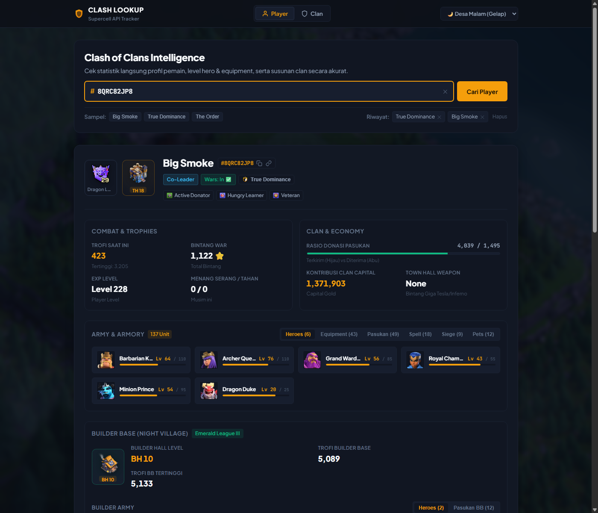
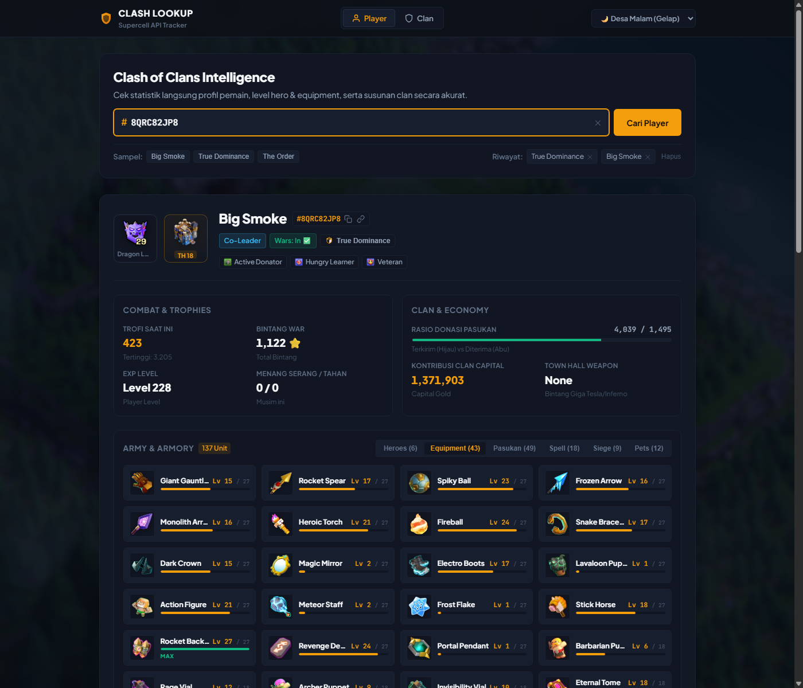
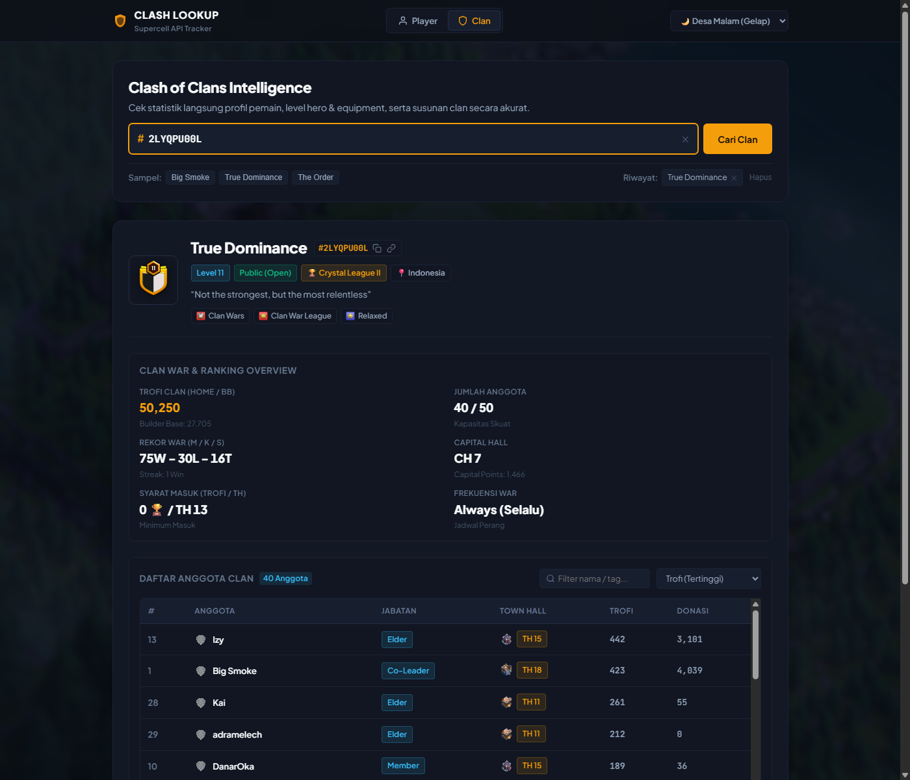
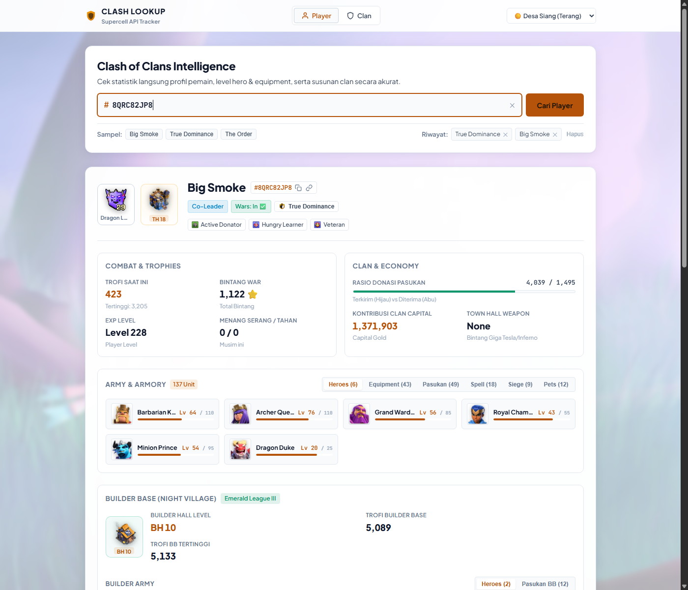

# ⚔️ Clash of Clans Player & Clan Lookup (Fullstack App)

A modern, fast, modular, and feature-rich fullstack web application for looking up live **Clash of Clans** player and clan statistics using the official Supercell API.


<p align="center">
  
</p>

---

## 📸 Screenshots & Showcase

### 1. 👤 Profil Pemain (Player Profile) & Army Armory
Tampilan profil detail pemain mencakup badge liga Dragon League Supercell, preview gedung Town Hall 18 dengan level weapon, rasio donasi pasukan, status war, serta tab armory lengkap.


---

### 2. 🔮 Hero Equipment & Level Progression
Sistem tab showcase equipment hero (Common & Epic) dengan artwork resmi resolusi tinggi, penyesuaian level, indikator progress bar visual, dan badge status `MAX`.



---

### 3. 🛡️ Profil Clan & Roster Anggota (Clan View)
Informasi komprehensif clan (badge resmi, level clan, war win streak, rekor war, capital hall) serta tabel anggota clan interaktif dengan fitur filter nama/tag dan sortir dinamis (Trofi, TH, Donasi).



---

### 4. ☀️ Pilihan Tema: Desa Siang (Terang) vs 🌙 Desa Malam (Gelap)
Tersedia selector tema suasana desa Clash of Clans dengan wallpaper resolusi tinggi dan kontras visual yang nyaman di mata.



---

## 🌟 Key Features

### 👤 Player Profile Lookup
- **Official Supercell Badges**: Live League badges (Dragon League, Titan, Legend, etc.) and Clan Badges.
- **Complete Army & Armory Showcase**: Interactive tabs with item count badges for:
  - 👑 **Heroes** (*Barbarian King, Archer Queen, Grand Warden, Royal Champion, Minion Prince, Dragon Duke*)
  - 🔮 **Hero Equipment** (Common & Epic equipment with custom artwork like *Portal Pendant, Giant Gauntlet, Fireball, Rocket Spear*)
  - ⚔️ **Pasukan / Troops** (*Elixir & Dark Elixir units*)
  - 🧪 **Spells** (*Elixir & Dark Elixir Spells*)
  - 🛡️ **Siege Machines** (*Wall Wrecker, Battle Blimp, Log Launcher, etc.*)
  - 🐾 **Pets** (*L.A.S.S.I, Mighty Yak, Unicorn, Phoenix, Spirit Fox, Angry Jelly, etc.*)
- **Visual Level Indicators**: High-resolution icons, progress bars, and glowing `MAX` indicators.
- **Home Village Stats**: Town Hall HD building preview (TH1–TH18) with weapon level, EXP level, current & best trophies, war stars, attack & defense wins.
- **Donation Ratio Tracker**: Real-time visual comparison bar of troops sent vs received.
- **Clan Capital**: Total capital gold contributed.
- **Builder Base (Night Village)**: Builder Hall preview (BH1–BH10), Builder Hall level pill, current & best trophies, and Builder Base units (*Battle Machine, Battle Copter, and BB Troops*).
- **Playstyle Labels**: Displays official playstyle labels with custom icons (e.g. *Active Donator, Veteran, Hungry Learner*).

### 🛡️ Clan Profile & Live Roster
- **Rich Clan Overview**: Level, clan points/trophies, member count (e.g. `40 / 50`), war league tier, capital hall level, trophy entry requirements, war frequency, and war win streak.
- **War Record Statistics**: Win / Loss / Tie record with smart private log handling.
- **Interactive Members Table**:
  - **One-Click Player Inspection**: Click any member in the table to instantly inspect their full profile.
  - **Live Filter**: Instant real-time search input to filter members by name or tag.
  - **Custom Sorting**: Sort members on the fly by **Trofi**, **Town Hall**, **Donasi**, or **Nama (A-Z)**.

### ⚡ User Experience & Modern Theming
- **Dual Tab Search**: Switch seamlessly between **Cari Player** and **Cari Clan**.
- **Deep Linking**: Share direct links with friends via `?player=TAG` or `?clan=TAG` with a 1-click share button (🔗).
- **Search History (Recent Searches)**: Saves up to 6 recently viewed profiles in `localStorage` with quick deletion chips.
- **In-Memory Cache (2 Minutes TTL)**: Drastically reduces API latency down to **~4ms** on repeated lookups while conserving Supercell API quota.
- **Curated Background Themes**:
  1. 🌙 **Desa Malam (Gelap)**: Atmospheric night village background with tactical dark glassmorphism.
  2. ☀️ **Desa Siang (Terang)**: Daylight village background with vibrant lighting and high contrast.

---

## 📁 Clean & Modular Architecture

The codebase follows a modular design without requiring complex bundlers, leveraging **Native ES Modules** and **CSS `@import`**:

```text
Clash-of-Clans-Lookup-Players/
├── docs/                                 # 📸 Documentation & Screenshots
│   └── screenshots/
│       ├── player-profile.png
│       ├── hero-equipment.png
│       ├── clan-profile.png
│       └── daylight-theme.png
│
├── src/                                  # ⚙️ Backend (Express & Node.js)
│   ├── config.js                         # Environment variables & port config
│   ├── server.js                         # Clean entrypoint
│   ├── controllers/
│   │   ├── playerController.js           # Player, heroes, troops, spells logic
│   │   └── clanController.js             # Clan profile & roster logic
│   ├── routes/
│   │   └── apiRoutes.js                  # Express API route declarations
│   └── services/
│       ├── clashApi.js                   # Supercell API HTTP client & tag validation
│       └── cache.js                      # In-memory TTL caching engine
│
├── public/                               # 🌐 Frontend
│   ├── index.html                        # Application markup (<script type="module">)
│   ├── app.js                            # Frontend orchestrator
│   ├── style.css                         # Master stylesheet importing modular CSS
│   │
│   ├── css/                              # 🎨 Modular Stylesheets
│   │   ├── variables.css                 # Color tokens, fonts, theme variables
│   │   ├── layout.css                    # Reset, village backgrounds, navbar
│   │   ├── components.css                # Search console, chips, toasts, badges
│   │   ├── player.css                    # Player card, armory tabs & grid
│   │   ├── clan.css                      # Clan card, stats & roster table
│   │   └── responsive.css                # Mobile & tablet breakpoints
│   │
│   ├── js/                               # ⚡ Native ES Modules
│   │   ├── dom.js                        # Cached DOM references & helpers
│   │   ├── api.js                        # Fetch request wrapper
│   │   ├── toast.js                      # User feedback toast notifications
│   │   ├── clipboard.js                  # Clipboard copy & deep link sync
│   │   ├── formatters.js                 # Role, clan type & label formatters
│   │   ├── assets.js                     # Clash King HD asset resolvers
│   │   ├── theme.js                      # Desa Malam & Desa Siang controller
│   │   ├── history.js                    # LocalStorage search history manager
│   │   ├── player.js                     # Player card & Armory renderer
│   │   └── clan.js                       # Clan card & Roster table renderer
│   │
│   └── assets/                           # Backgrounds and fallback SVGs
```

---

## 🚀 Quick Start Guide

### 1. Clone & Install Dependencies
```bash
git clone https://github.com/KiyyKen/Clash-of-Clans-Lookup-Players.git
cd Clash-of-Clans-Lookup-Players
npm install
```

### 2. Configure Environment Variables
Create a `.env` file in the project root:
```env
COC_API_KEY=your_supercell_api_token_here
PORT=3000
```

> [!IMPORTANT]
> The Clash of Clans developer portal requires your **Allowed IP Address** to match your current public IP. Check your current public IP (e.g. via [ipify.org](https://api.ipify.org)) and add it to your key in [developer.clashofclans.com](https://developer.clashofclans.com/).

### 3. Run the Server

**Development Mode (auto-reload via nodemon):**
```bash
npm run dev
```

**Production Mode:**
```bash
npm start
```

Open your browser at:
👉 **`http://localhost:3000`**

---

## 🔌 API Endpoints (Local Backend)

| Method | Endpoint | Description |
|---|---|---|
| `GET` | `/player/:tag` | Fetches rich profile, heroes, equipment, and village stats |
| `GET` | `/players/:tag` | Alias route for `/player/:tag` |
| `GET` | `/clan/:tag` | Fetches clan details, war stats, capital level, and badge |
| `GET` | `/clans/:tag` | Alias route for `/clan/:tag` |
| `GET` | `/clan/:tag/members` | Fetches full member list with TH, rank, trophies, and donations |
| `GET` | `/clans/:tag/members` | Alias route for `/clan/:tag/members` |

---

## 📜 License
This project is open-source under the [ISC License](LICENSE).
Clash of Clans and its respective logos and assets are trademarks of Supercell Oy.
